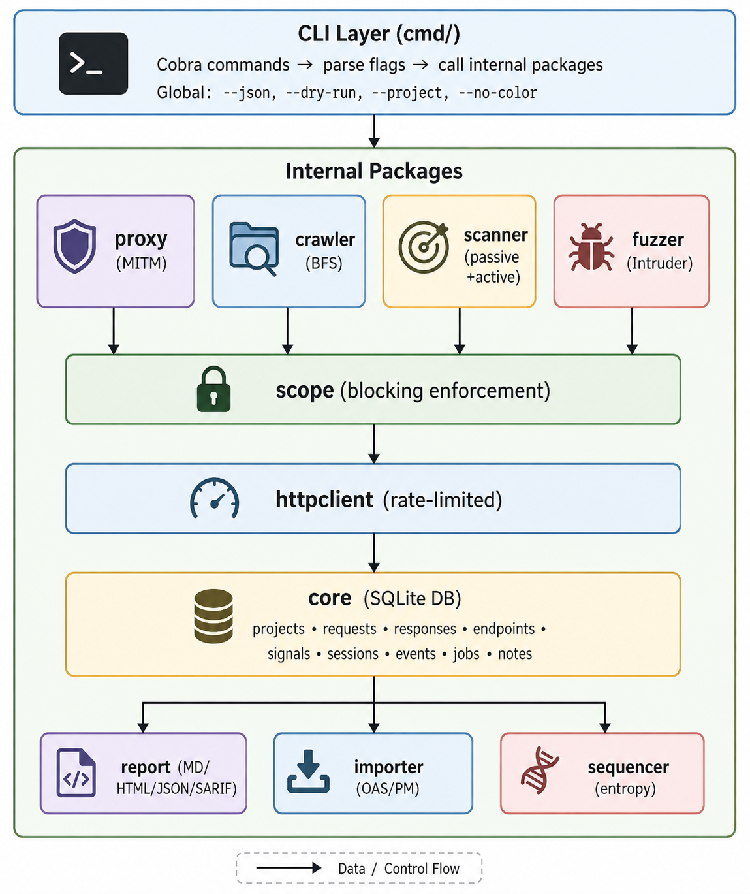

# Architecture

Internal design of AgentBurp — data model, package structure, concurrency model, and extension points.

---

## High-Level Architecture



---

## Package Breakdown

### Core (`internal/core/`)

The foundation layer. Manages SQLite database, project lifecycle, job tracking, ID generation, and configuration.

| File | Responsibility |
|---|---|
| `db.go` | SQLite connection, WAL mode, schema migration (18 tables) |
| `project.go` | Project CRUD (create, get, list, soft-delete) |
| `jobs.go` | Async job lifecycle (queued → running → done/failed/cancelled) |
| `ids.go` | Crypto-secure nanoid generation with prefixed IDs |
| `config.go` | Per-project JSON configuration (proxy port, rate limits, etc.) |

**Key design decisions:**
- `SetMaxOpenConns(1)` — SQLite's single-writer constraint
- WAL journal mode + foreign keys enabled at connection time
- IDs use `crypto/rand` with panic-on-failure (never produce predictable IDs)
- Soft-delete for projects (`active = 0`)

### Scope (`internal/scope/`)

Safety-critical scope enforcement. **Blocking, not advisory.**

| File | Responsibility |
|---|---|
| `scope.go` | Rule evaluation engine with regex caching |
| `audit.go` | Immutable audit logger for scope violations and actions |

**Evaluation order:** Rules are evaluated in order, last matching rule wins (mirrors Burp's behavior).

**Pattern types:** `host` (with `*.` wildcard), `url` (prefix match), `regex` (pre-compiled and cached).

### Proxy (`internal/proxy/`)

MITM proxy built on `go-mitmproxy`.

| File | Responsibility |
|---|---|
| `proxy.go` | Proxy lifecycle, TLS interception config |
| `capture.go` | Capture addon — stores requests/responses, builds endpoint map |

The capture addon processes every proxied exchange:
1. Checks scope (blocks if out-of-scope)
2. Normalizes URL → endpoint
3. Extracts parameters
4. Stores request + response in SQLite
5. Logs to audit trail

### Scanner (`internal/scanner/`)

Two-phase scanning: passive (no requests sent) and active (targeted probes).

| File | Responsibility |
|---|---|
| `passive.go` | 14 passive checks against stored traffic |
| `active.go` | 8 active probe implementations |
| `runner.go` | Scan orchestration and job management |
| `findings.go` | Finding deduplication and storage |

**Passive checks:** Run against stored request/response pairs without sending any network traffic. Each check receives an `Exchange` struct and returns a `Signal` (finding) or nil.

**Active probes:** Each probe constructs a targeted request, sends it through the rate-limited `httpclient`, and analyzes the response for vulnerability indicators.

**Deduplication:** Findings are deduplicated by (endpoint_id, check_id) — one finding per check per endpoint.

### Fuzzer (`internal/fuzzer/`)

Intruder-style payload injection engine.

| File | Responsibility |
|---|---|
| `fuzzer.go` | Core engine: position resolution, payload iteration, baseline comparison |
| `positions.go` | Position parsing: `query.param`, `body.field`, `header.Name`, `cookie.name`, `path.0` |
| `payloads.go` | Built-in payload generators (numbers, mutations) |
| `attacks.go` | Attack type combinatorics (sniper, battering ram, pitchfork, cluster bomb) |
| `filters.go` | Response filtering (status code, body length, regex match) |

**Attack types:**
- **Sniper** — one position at a time, one payload list
- **Battering ram** — all positions simultaneously, same payload
- **Pitchfork** — parallel iteration across payload lists
- **Cluster bomb** — cartesian product of all payload lists

**Anomaly detection:** Automatically flags responses that deviate from baseline by >2σ in status code, body length, or response time.

### Crawler (`internal/crawler/`)

BFS web crawler with optional headless Chrome.

| File | Responsibility |
|---|---|
| `crawler.go` | BFS orchestration, scope check, dedup |
| `htmlcrawl.go` | HTML link/form extraction |
| `jscrawl.go` | JavaScript path extraction (static analysis) |
| `rodcrawl.go` | Headless Chrome crawling via go-rod |
| `dedup.go` | URL normalization and deduplication |

### HTTP Client (`internal/httpclient/`)

Shared, rate-limited HTTP client used by fuzzer, crawler, scanner, and repeater.

| Feature | Implementation |
|---|---|
| Per-host rate limiting | `sync.Mutex` per-host `rateSlot` with `time.NewTimer` |
| Redirect cookie merging | Collects `Set-Cookie` from every redirect hop |
| Response body cap | `io.LimitReader` at 50MB to prevent OOM |
| Timeout | Configurable per-request (default 30s) |

### Models (`internal/models/`)

Canonical data structures that define the JSON schema for all outputs. Bodies are excluded from JSON serialization by default (`json:"-"`).

### Report (`internal/report/`)

Multi-format report generation.

| File | Format |
|---|---|
| `report.go` | Data loading + orchestration |
| `markdown.go` | Markdown report |
| `html.go` | Self-contained HTML report |
| `json.go` | JSON export |
| `sarif.go` | SARIF 2.1.0 (CI/CD integration) |

---

## Data Model

### SQLite Schema

```
projects          ← top-level container
├── requests      ← captured HTTP requests
│   └── responses ← HTTP responses (1:1 with requests)
├── endpoints     ← normalized URL patterns
│   └── params    ← discovered parameters per endpoint
├── signals       ← security findings
├── scope_rules   ← include/exclude rules
├── sessions      ← auth sessions (cookies, headers, tokens)
├── events        ← immutable audit log
├── jobs          ← async job tracking
├── notes         ← user annotations
├── auth_profiles ← login configuration
├── repeater_requests ← cloned/composed requests
├── transport_profiles ← HTTP backend profiles
├── proxy_profiles ← upstream proxy profiles
├── policies      ← rate limit / backoff policies
├── workflows     ← YAML state sequences
├── workflow_runs ← workflow execution history
├── detections    ← WAF/anti-bot detection events
└── adaptation_rules ← detection → action mappings
```

### ID System

All IDs are generated by `core.NewID(prefix)`:

```go
func NewID(prefix string) string {
    return prefix + "_" + nanoid(12)
}
```

- 12-character nanoid using `crypto/rand`
- 62-character alphabet (a-z, A-Z, 0-9)
- ~71 bits of entropy per ID
- Collision probability: negligible at any practical scale

---

## Concurrency Model

- **SQLite:** Single writer (`SetMaxOpenConns(1)`), WAL mode for concurrent reads
- **Rate limiter:** `sync.Mutex` per-host slot with timer-based waiting
- **Crawler:** Configurable worker pool (`--concurrency`)
- **Fuzzer:** Configurable worker pool with per-host rate limiting
- **Jobs:** Tracked in SQLite, one job at a time per type per project

---

## Extension Points

### Adding a Passive Check

1. Add a function in `internal/scanner/passive.go`:
   ```go
   func checkMyNewCheck(ex *Exchange) *models.Signal {
       // Analyze ex.ReqHeaders, ex.RespHeaders, ex.RespBody, etc.
       if vulnerable {
           sig := signalFrom(ex, "my-check-id", "Title", "medium", "high")
           sig.Explanation = "..."
           sig.Remediation = "..."
           return sig
       }
       return nil
   }
   ```

2. Wire it into the `RunPassive` function's check list.

3. Add tests in `passive_test.go`.

### Adding an Active Probe

1. Add a function in `internal/scanner/active.go`:
   ```go
   func probeMyProbe(ctx context.Context, client *httpclient.Client, ...) *Probe {
       // Construct and send probe request
       // Analyze response for vulnerability indicators
       return &Probe{Name: "my-probe", Result: "...", Severity: "high"}
   }
   ```

2. Call it from `RunActive`.

3. Add tests in `active_test.go`.

### Adding a Report Format

1. Add a new file in `internal/report/` (e.g., `csv.go`)
2. Implement the generation function that takes `*ReportData`
3. Wire it into the format switch in `report.go`

### Adding a Transport

1. Implement the `Transport` interface in `internal/transport/transport.go`:
   ```go
   type Transport interface {
       Send(ctx context.Context, req *OutboundRequest) (*Response, error)
       Name() string
       SupportsCookies() bool
       SupportsJS() bool
       Type() Type
   }
   ```

2. Register it in `NewRegistry()`.

---

## Dependencies

| Dependency | Purpose |
|---|---|
| `modernc.org/sqlite` | Pure-Go SQLite (no CGO) |
| `github.com/spf13/cobra` | CLI framework |
| `github.com/spf13/viper` | Configuration management |
| `github.com/go-rod/rod` | Headless Chrome (optional, for JS crawling) |
| `github.com/lqqyt2423/go-mitmproxy` | HTTP/HTTPS MITM proxy |
| `gopkg.in/yaml.v3` | YAML parsing (auth configs, workflows, policies) |

Zero CGO. Single binary. Runs anywhere.
